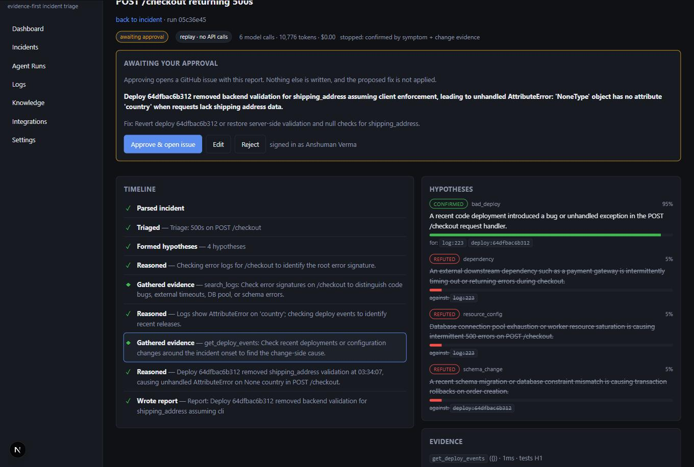
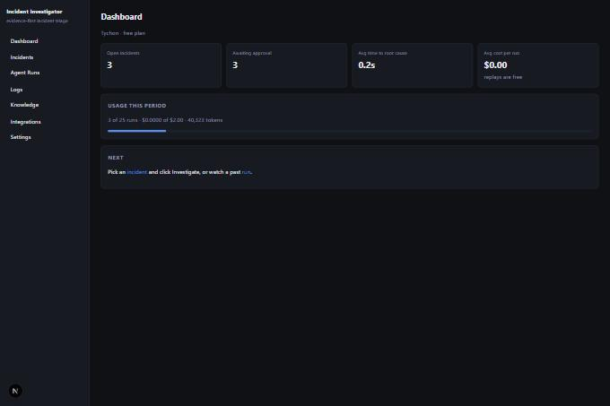
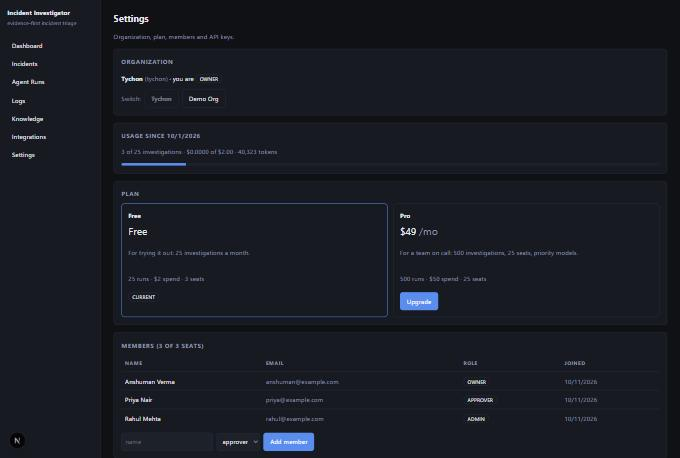
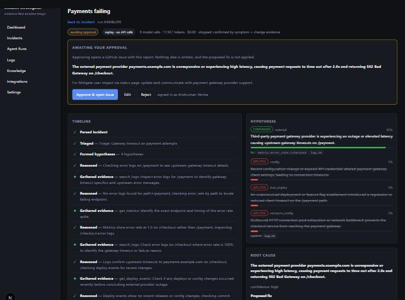

# AI DevOps Incident Investigator

An agent that investigates production incidents the way an on-call engineer does: it forms
hypotheses, gathers evidence from logs, metrics, the database, deploy events and git history,
**rules the wrong ones out visibly**, and writes a report where every claim cites the tool
result it came from. It stops before taking any action — opening a GitHub issue needs a human.

It is multi-tenant, meters its own cost against plan limits, and ships an eval suite that
publishes how often it is right, including when it is wrong.

```
Reasoned   — Logs show AttributeError on 'country'; checking deploy events.
Gathered   — get_deploy_events: what shipped before the errors started
  H1 -> CONFIRMED (0.9)  A recent deployment introduced a bug in POST /checkout
  H2 -> REFUTED   (0.1)  An external payment gateway is timing out
  H3 -> REFUTED   (0.1)  Database connection pool exhaustion

ROOT CAUSE: Deploy 64dfbac6 removed backend validation for shipping_address,
            leading to AttributeError: 'NoneType' has no attribute 'country'
evidence: deploy:64dfbac6b312, log:223     confidence=high  external=False
stop: confirmed by symptom + change evidence | 6 model calls | $0.079
```

**Measured, not claimed** ([full table](docs/eval-results.md)): mean score **0.83** over six
scenarios, the "is this even our bug?" call right **6/6**, at roughly **$0.08 per
investigation**. The misses are in the table too.

## Try it without an API key

Every investigation is recorded, so the whole thing replays for free:

```bash
python dev.py                                   # web :3000 · api :8000 · target app :8080
python investigate.py --replay cassettes/s01_null_check.jsonl "500s on checkout"
```

Or in the browser: **Incidents → Report incident → Investigate**, with the dropdown on
**Replay**. See [docs/demo.md](docs/demo.md) for the 90-second walkthrough.

## Screenshots

| | |
|---|---|
|  |  |
| The investigation as it happens: hypotheses confirmed or refuted with their citations, the evidence behind any step one click away, and the approval gate the agent cannot pass by itself. | Open incidents, time to root cause, cost per run, and usage against the plan limit. |
|  |  |
| Organization, plan, usage meter, members and roles. | The "not our bug" case - it searches the wrong endpoint first, recovers, and concludes external. |

More in [docs/screenshots](docs/screenshots/).

## Layout

```
apps/
  web/          Next.js + TypeScript dashboard, live run view
  api/          FastAPI: REST, SSE streaming, auth
  worker/       Background jobs that execute agent runs
  target-app/   The "victim" checkout service + fault injector
packages/
  agent/        LangGraph graph: state, nodes, prompts, schemas
  mcp-server/   Read-only investigation tools exposed over MCP
  evals/        Scripted incidents, runner, scoring
cassettes/      recorded runs: replay an investigation with no API key
infra/          docker-compose, otel-collector config, DB init
docs/           architecture, threat model, demo script, eval results
```

## Quick start (local, no Docker)

Needs Python 3.11+, [uv](https://docs.astral.sh/uv/) (`pip install uv`) and Node 20+.

```bash
python dev.py     # starts web (3000), api (8000), target-app (8080); Ctrl+C stops all
python test.py    # runs tests for every Python package
```

First run installs dependencies and seeds `target-repo/` (the victim's git history, 30 commits).

## Break the target app

```bash
python fault.py list                       # every scenario and whether it reproduces
python fault.py apply s01_null_check       # commit a culprit, deploy it, send traffic
python fault.py reset                      # back to a healthy main
```

Six scenarios reproduce end to end, chosen to cover different classes of cause:

| scenario | class | what makes it interesting |
|---|---|---|
| `s01_null_check` | bad deploy | the textbook case: a commit removes a guard |
| `s03_pool_exhaustion` | resource config | the symptom is saturation; the cause is a config commit |
| `s04_rotated_key` | config/secret | **nothing was deployed** — and it is still our fault |
| `s05_n_plus_one` | performance | slow, not broken; no errors to grep for |
| `s07_feature_flag` | config | fails only in some regions |
| `s08_provider_outage` | external | the right answer is "not our bug" |

Evidence lands in `data/checkout.db` (`app_logs` with stack traces, `metrics_samples`,
`deploy_events`) and the culprit commit is in `target-repo/`. `GET /health` reports the running
SHA. Four more scenarios are catalogued but not yet reproducible, and `fault.py list` says so.

## Evals

```bash
python evals.py --replay          # free, deterministic: what CI runs
python evals.py --repeat 3        # live, to show run-to-run variance
```

Writes [docs/eval-results.md](docs/eval-results.md) and a JSON sibling. Scoring is deliberately
unkind: a report only scores the culprit if it cites the file or config that actually caused the
incident, which means reading the change rather than trusting the commit message. Two runs name
the right commit and lose that point because they never opened the diff — that stays in the table.

## Ask the investigation tools (what the agent will call)

```bash
python tools.py search_logs level=ERROR limit=5          # grouped error signatures + stack tails
python tools.py get_metrics metric=error_rate path=/checkout   # series + detected change points
python tools.py get_deploy_events                        # what shipped in the window
python tools.py list_commits limit=5                     # deployed branch, HEAD marked
python tools.py get_commit_diff sha=HEAD                 # the diff
python tools.py query_database "sql=select status, count(*) from orders group by status"
```

All tools are read-only: SQLite is opened `mode=ro`, SQL is parsed and must be a single
SELECT (row-capped, 5s timeout), git is read via `git log/show` only.

## Run the agent

Put an API key in `.env` (copy `.env.example`; `LLM_PROVIDER` = anthropic | openai | gemini), then:

```bash
python fault.py apply s01_null_check                 # break the shop
python investigate.py "POST /checkout returning 500s since a few minutes ago, ~30% of requests"
python evals.py                                      # all 3 cases: inject -> investigate -> score
```

The agent runs a hypothesis loop: triage (small model) -> 3-5 hypotheses -> repeat {one tool
call, evaluate} until a hypothesis is confirmed by 2 independent tools or a budget ends -> report.
Every citation must reuse a `source_ref` a tool actually returned; anything else is dropped by the
validator.

A cause counts as confirmed only with evidence from **both** sides - the symptom users hit
(`search_logs`, `get_metrics`, `query_database`) and what changed to cause it
(`get_deploy_events`, `list_commits`, `get_commit_diff`). Two symptoms agreeing is not a root
cause: an exhausted connection pool is a symptom, and something changed to exhaust it. If the
change tools find nothing shipped, that absence is the change-side evidence and points to an
external cause, so "not our bug" stays reachable. The loop will fetch the missing side itself
rather than let a report be written on half the evidence.

### Cost control

Measured: **~$0.08 per investigation** on Claude Sonnet 5 (6 LLM calls, ~21K tokens), and each run
prints its own cost.

| Control | Effect |
|---|---|
| `AGENT_MAX_COST_USD` (default `0.10`) | hard cap: the loop stops and reports what it has |
| `AGENT_MAX_STEPS` / `_TOKENS` / `_SECONDS` | step, token and wall-clock caps |
| prompt caching | the system prompt is cached, so repeat calls bill it at ~10% |
| `AGENT_CHEAP_REPORT=1` | write the report with the small model too |
| `LLM_MODEL=claude-haiku-4-5` | cheapest end-to-end |

### Free replay (demos, videos, UI work)

Record a run once, then reproduce it exactly with **zero API calls**:

```bash
python investigate.py --record cassettes/s08_provider_outage.jsonl "Payments failing since ..."
python investigate.py --replay cassettes/s08_provider_outage.jsonl "Payments failing since ..."
```

Cassettes record the model's reasoning **and** every tool result, so a replay needs neither an API
key nor the target app: `cassettes/` is committed, and a fresh clone can watch all three
investigations. Matching prefers an exact prompt and otherwise plays the next recording of that
step in order, because prompts carry a timestamp and the growing evidence ledger.

## The live run view

`python dev.py`, open http://localhost:3000, report an incident (the form has a preset per
scenario) and click **Investigate**. The timeline fills in as the agent works: each step is
clickable and opens the exact tool call, its raw output, and the `source_ref`s that may be cited
from it. The hypotheses panel shows confidence per hypothesis, flipping to CONFIRMED or REFUTED
live.

The Investigate control also offers a **replay** per scenario, which runs the whole investigation
from a cassette: no API key, no cost, identical every time. That is the demo path.

Events are streamed over SSE and stored, so a refresh mid-run resumes from where the browser left
off rather than restarting. The API executes runs off the request path behind an event bus with a
Redis-shaped interface, so moving to a separate worker process later is a swap, not a rewrite.

## The approval gate

The agent stops after writing its report. Nothing is filed until a person signs in, reviews it and
clicks **Approve** - and the reviewer can correct the root cause or the fix first, in which case
their version is what gets posted.

- **Creating a GitHub issue is the only write action in the system**, and it is not an agent tool.
  It runs from the trusted side after approval, so no model output can trigger it, and the token
  never enters a prompt.
- **A paused run is durable.** Graph state is checkpointed to `data/checkpoints.sqlite`, so a run
  can wait hours and still resume - verified by stopping the whole stack and approving afterwards.
- **Decisions are audited**: who approved or rejected, which fields they edited, and the issue that
  resulted. `GET /runs/{id}/audit`.
- **Without `GITHUB_TOKEN` the approval is a dry run**: the flow works end to end and says plainly
  that nothing was posted. Set `GITHUB_TOKEN` (issues:write only) and `GITHUB_REPO` to file for
  real.

## Multi-tenant SaaS

Organizations are the tenant boundary. Every tenant-owned row carries `org_id`, every query filters
on it, and a request for another org's incident is a 404 rather than a filtered list - tests cover
that directly.

| Concern | How |
|---|---|
| Roles | `owner > admin > approver > viewer`, held per organization in `memberships`, so one person can hold different roles in different orgs |
| Approval | needs a signed-in **person**: an API key is refused even though it may start investigations |
| Plans | Free (25 runs, $2, 3 seats) and Pro (500 runs, $50, 25 seats); limits live on the org so a tenant can be given a bespoke ceiling |
| Metering | usage is computed from runs for the calendar month: investigations, spend and tokens |
| Limits | exceeding them returns **402** and blocks new runs - but never a replay, which spends nothing, and never the recording of an incoming alert |
| API keys | hashed, shown once, revocable, with last-used tracking |
| Billing | Stripe Checkout in test mode; without keys an upgrade is applied directly and flagged `simulated` |
| Audit | approvals, edits, role changes, key creation and plan changes, all with an actor |

### Alerts in without a browser

```bash
curl -X POST http://localhost:8000/v1/incidents   -H "Authorization: Bearer $INVESTIGATOR_API_KEY"   -H "content-type: application/json"   -d '{"title":"Checkout 500s","description":"Error rate above 20% for 5 minutes"}'
```

That opens the incident and starts the investigation. If the plan is exhausted the incident is
still recorded and the response says why nothing ran - losing an alert to a billing limit would be
worse than not investigating it.

### Free path (no credit card)

`LLM_PROVIDER=gemini` with an AI Studio key runs on Google's free tier. A full investigation is
~14K tokens. Record it once and every later demo replays for free. All three scenarios were recorded this way on `gemini-3.8-flash` at no cost:

| Scenario | Agent's conclusion | Evidence |
|---|---|---|
| bad deploy | named the commit that removed the null check | logs + deploy event |
| pool exhaustion | the deploy that shrank the pool - fix is revert, not "raise the limit" | QueuePool error + deploy event |
| provider outage | `external=true`, no commit blamed, mitigation not a code change | upstream timeouts + empty deploy history |

## Observability

With `OTEL_EXPORTER_OTLP_ENDPOINT` set (Jaeger, Tempo, anything OTLP), each run emits one trace:
a span per graph node, model call and tool call, carrying tokens, cost and latency. For a quick
look without a collector:

```bash
OTEL_CONSOLE=1 python investigate.py --replay cassettes/s05_n_plus_one.jsonl "slow checkout"
```

## Status

| # | Phase | |
|---|---|---|
| 0 | Foundation: repo, skeletons, CI | done |
| 1 | Target app + fault injector | done |
| 2 | Read-only MCP tools | done |
| 3 | Agent: hypothesis loop, evidence rules, cost caps | done |
| 4 | Live UI: SSE streaming, evidence drawer | done |
| 5 | Approval gate, GitHub issue, durable pause | done |
| 6 | SaaS: orgs, roles, plans, API keys, billing | done |
| 7 | Six scenarios, eval suite with published numbers, OTel | done |
| 8 | Deploy to a public URL | not started |

Deliberately not done: pgvector retrieval over past incidents, four of the ten catalogued
scenarios, and a hosted deployment. The architecture leaves seams for all three —
[docs/architecture.md](docs/architecture.md) names them.

## Docs

- [architecture.md](docs/architecture.md) — the loop, the stopping rule, the deployment seams
- [threat-model.md](docs/threat-model.md) — what the agent can and cannot do, and why
- [demo.md](docs/demo.md) — the 90-second script
- [eval-results.md](docs/eval-results.md) — the numbers, including the failures
